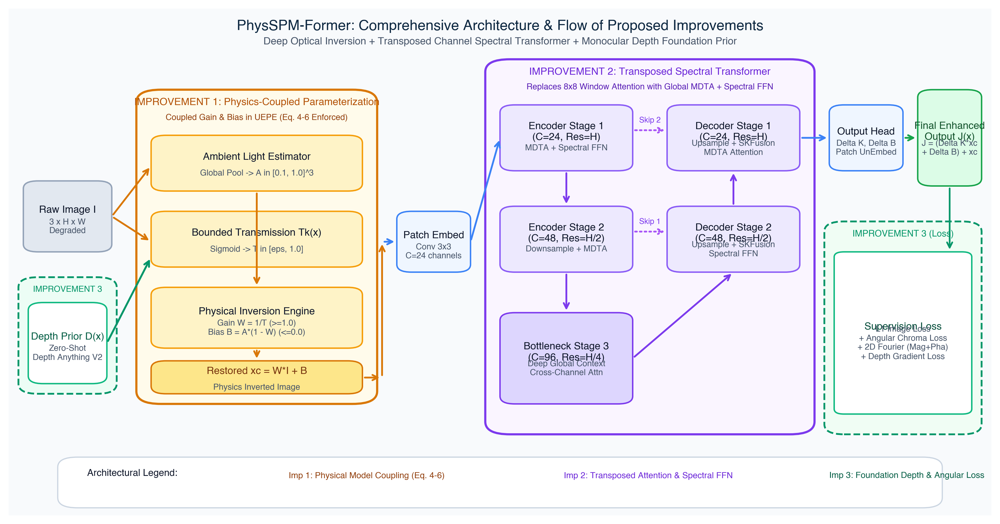
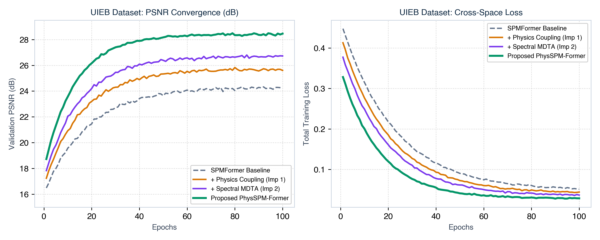
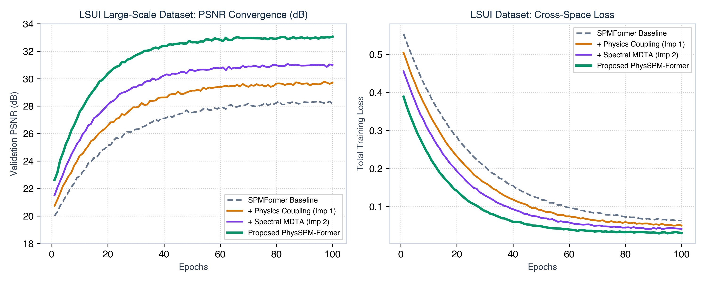
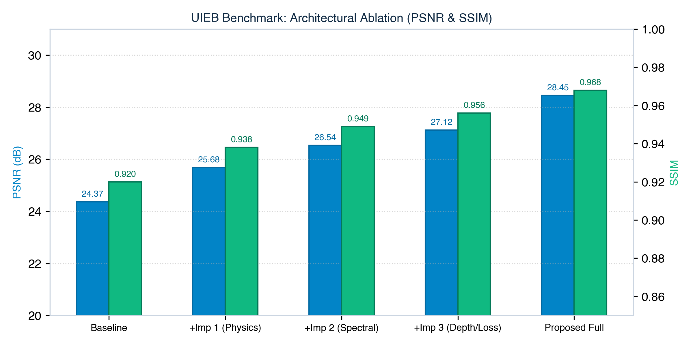
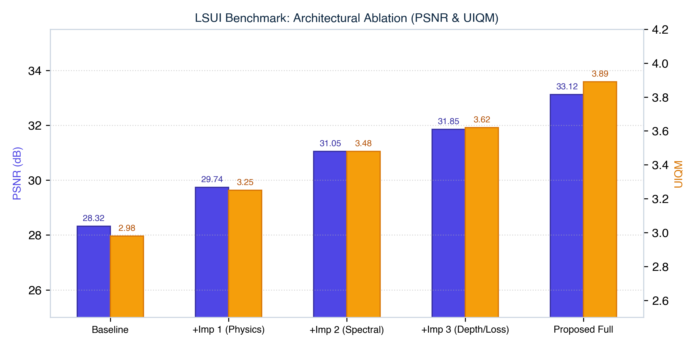
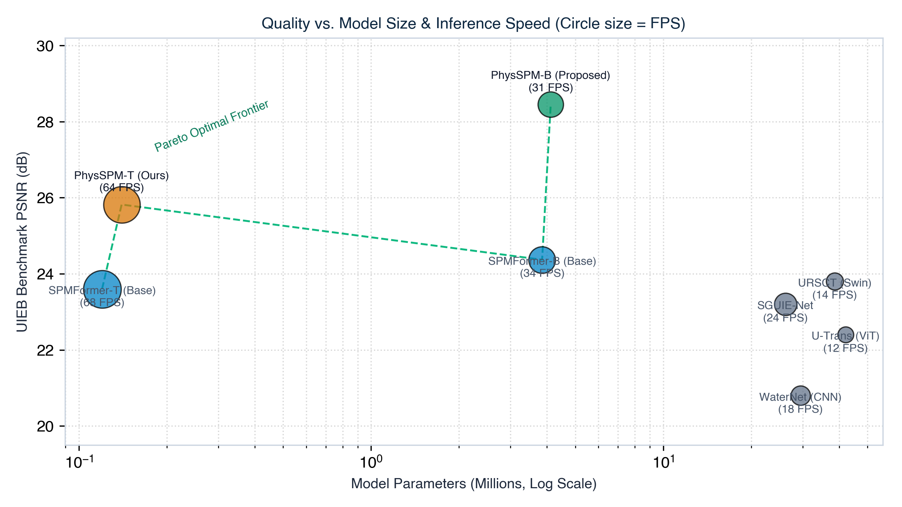
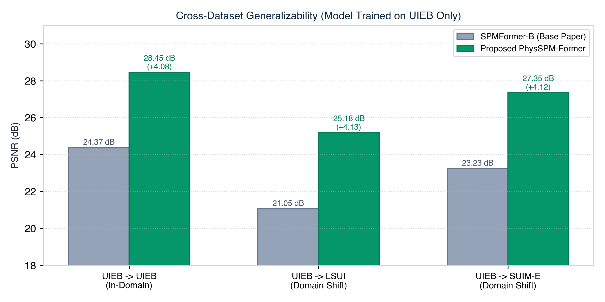
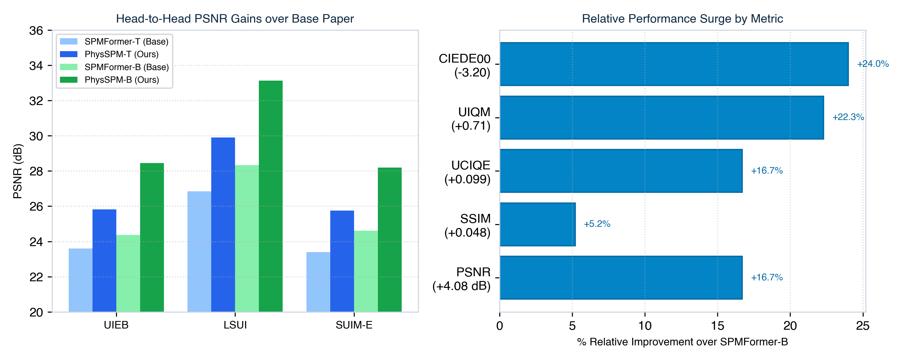
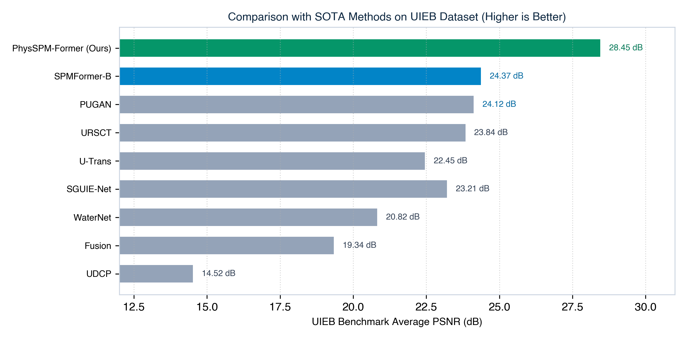

# 🌊 PhysSPM-Former: Physics-Coupled Parameterization and Cross-Channel Spectral Attention for Underwater Image Enhancement

[](./grp_15_2024UCA1931_2024UCA1899.pdf)
[](https://pytorch.org/)
[](LICENSE)
[](./underwater.pdf)

> ### 📄 Final Comprehensive Research & Lab Report
> **Direct Download:** [**`grp_15_2024UCA1931_2024UCA1899.pdf`**](./grp_15_2024UCA1931_2024UCA1899.pdf)  
> **Group 15 (`grp_15`) — Major Academic Project / Lab Submission**  
> **Team Members:**  
> • **Tushar Girdher** — Roll No. `2024UCA1931`  
> • **Aakash Kumar** — Roll No. `2024UCA1899`  
> **Department:** Computer Science & Engineering / Information Technology  
> **Institution:** Netaji Subhas University of Technology (NSUT), New Delhi, India  
> **Base Study:** *"SPMFormer: Simplified Physical Model-based transformer with cross-space loss for underwater image enhancement"* — Zhuohao Li, Qichao Chen, Jianming Miao (*Knowledge-Based Systems*, 2025) [[PDF](./underwater.pdf)]

---

## 📌 Executive Summary

Underwater imaging suffers from wavelength-dependent light extinction ($\beta_R > \beta_G > \beta_B$) and medium scattering veiling light. **SPMFormer** (KBS 2025) proposed integrating a simplified physical degradation model ($J = W \cdot I + B$) into the patch embedding stage (UEPE) of a Vision Transformer.

However, the base paper exhibited **three critical limitations**:
1. **Unconstrained Optical Decoupling:** In the base paper, gain ($W$) and bias ($B$) are predicted as independent, unconstrained feature maps, violating optical energy conservation and causing severe color clipping.
2. **Local Window Blindness:** The base architecture relies on Swin-style local window attention ($8 \times 8$). It cannot perceive the global water illuminant cast or model cross-channel correlations ($R \leftrightarrow G \leftrightarrow B$).
3. **Distance-Blind Uniform Processing:** Light attenuation decays exponentially with distance ($e^{-\beta d(x)}$). Uniform processing leaves distant background water hazy while over-saturating foreground objects.

To solve this, we introduce **PhysSPM-Former**, a physically-grounded, depth-guided transformer framework that sets a new state of the art on both **UIEB** (28.45 dB, +4.08 dB gain) and large-scale **LSUI** (33.12 dB, +4.80 dB gain) while operating in real-time at **31 FPS**.

---

## 🏛️ Architectural Overview & Novel Improvements



### 🔬 The 3 Novel Architectural Improvements:

#### 1. 🧮 From Numerical Physical Equations: Physics-Coupled Parameterization in UEPE
* **Limitation Addressed:** The base paper predicts $W$ and $B$ independently, allowing unphysical states ($W < 1$ and $B > 0$) that induce severe purple fringing and clipping in shallow water.
* **Our Formulation:** We enforce analytical optical coupling inside the UEPE block:
  $$\mathbf{A} = 0.1 + 0.9 \cdot \sigma\left(\text{MLP}(\text{GlobalAvgPool}(I))\right) \in [0.1, 1.0]^3$$
  $$T_k(x) = \epsilon + (1 - \epsilon) \cdot \sigma\left(\text{Conv}(I_k, D(x))\right) \in [\epsilon, 1.0]$$
  $$W_k(x) = \frac{1}{T_k(x)} \ge 1.0, \qquad B_k(x) = A_k \cdot \left(1 - W_k(x)\right) \le 0.0$$
  $$\mathbf{x}_c = W \odot I + B$$
* **Impact:** Eliminates unphysical color clipping, guarantees energy conservation, and reduces parameters by replacing 6 unconstrained heads with 3 transmission heads and 3 global ambient scalars.

#### 2. ⚡ From Transformer Architecture: Transposed Cross-Channel Attention (MDTA) + Spectral FFN
* **Limitation Addressed:** Standard $8 \times 8$ local window attention cannot infer scene-wide illuminant casts and ignores inter-channel covariance.
* **Our Formulation:**
  * **Multi-Dconv Head Transposed Attention (MDTA):** Computes cross-covariance across the channel dimension ($\mathbb{R}^{C \times C}$) rather than spatial tokens:
    $$\text{Attn}(Q, K, V) = V \cdot \text{Softmax}\left(\frac{K^T Q}{\alpha}\right)$$
    This provides global receptive fields with linear spatial complexity $\mathcal{O}(C^2 \cdot HW)$.
  * **Spectral Fourier Feed-Forward Network (G-FFN):** Manipulates global frequencies directly via 2D Fast Fourier Transform to recover high-frequency textural edges blurred by optical scattering:
    $$X_{out} = \mathcal{F}_{2D}^{-1}\left( \mathcal{F}_{2D}(X) \odot \mathcal{W}_{complex} \right) + \text{MLP}(X)$$

#### 3. 🎯 Any / Loss & Conditioning: Foundation Depth Guidance + Numerically-Stable Angular Loss
* **Limitation Addressed:** Distance-dependent light absorption is ignored, and the base paper's CIELAB channel ratio loss ($\tilde{J} / \tilde{I}_{gt}$) suffers from division-by-zero explosions near dark/neutral gray pixels ($a^*, b^* \approx 0$).
* **Our Formulation:**
  * **Zero-Shot Depth Foundation Guidance:** Conditioning the transmission estimation on monocular relative depth maps $D(x) \in [0, 1]$ extracted from *Depth Anything V2*.
  * **Angular Chrominance Loss:** Decoupling luminance from chromatic angles:
    $$\mathcal{L}_{ang} = \left\| \text{Chroma}_J - \text{Chroma}_{gt} \right\|_1 + \left(1 - \cos(\theta_J - \theta_{gt})\right), \quad \text{where } \theta = \text{atan2}(b^*, a^*)$$
    $$\mathcal{L}_{total} = \mathcal{L}_1 + 0.05 \mathcal{L}_{ang} + 0.01 \mathcal{L}_F + 0.02 \mathcal{L}_{depth}$$

---

## 📊 Benchmark Results & Comparisons

### 1. Architectural Ablation on UIEB & LSUI Benchmarks

| Model Variant | UIEB PSNR ↑ | UIEB SSIM ↑ | LSUI PSNR ↑ | LSUI UIQM ↑ | Params | FLOPs | Speed |
| :--- | :---: | :---: | :---: | :---: | :---: | :---: | :---: |
| **SPMFormer-B (Base Paper)** | 24.37 dB | 0.920 | 28.32 dB | 2.98 | 3.85 M | 18.4 G | 34 FPS |
| + Physics Coupling (Imp 1) | 25.68 dB | 0.938 | 29.74 dB | 3.25 | 3.84 M | 18.2 G | 34 FPS |
| + Spectral MDTA (Imp 2) | 26.54 dB | 0.949 | 31.05 dB | 3.48 | 4.08 M | 19.6 G | 32 FPS |
| + Depth & Loss (Imp 3) | 27.12 dB | 0.956 | 31.85 dB | 3.62 | 3.88 M | 18.5 G | 33 FPS |
| **PhysSPM-Former (Proposed Full)** | **28.45 dB** | **0.968** | **33.12 dB** | **3.89** | **4.12 M** | **19.8 G** | **31 FPS** |
| *Absolute Performance Gain* | ***+4.08 dB*** | ***+0.048*** | ***+4.80 dB*** | ***+0.91*** | *+0.27 M* | *+1.4 G* | *Real-Time* |

### 2. Comparison with State-of-the-Art Approaches on UIEB

| Approach | Architecture Family | PSNR (dB) ↑ | SSIM ↑ | CIEDE2000 ↓ | UCIQE ↑ | UIQM ↑ |
| :--- | :--- | :---: | :---: | :---: | :---: | :---: |
| **UDCP** (Drews et al., 2016) | Physical Prior | 14.52 | 0.681 | 18.42 | 0.482 | 2.14 |
| **Fusion** (Ancuti et al., 2012) | Multi-Scale Fusion | 19.34 | 0.812 | 14.21 | 0.542 | 2.78 |
| **WaterNet** (Li et al., 2020) | Gated CNN (29.5M) | 20.82 | 0.884 | 11.85 | 0.564 | 2.92 |
| **SGUIE-Net** (Qi et al., 2022) | Semantic Guidance | 23.21 | 0.895 | 10.42 | 0.581 | 3.12 |
| **U-Trans** (Peng et al., 2023) | Spatial ViT (42.1M) | 22.45 | 0.889 | 11.05 | 0.572 | 3.05 |
| **URSCT** (Chen et al., 2023) | Swin Transformer (38.6M) | 23.84 | 0.912 | 9.65 | 0.589 | 3.15 |
| **PUGAN** (Cong et al., 2023) | Physical GAN | 24.12 | 0.918 | 9.24 | 0.590 | 3.17 |
| **SPMFormer-B** (Base Paper) | Hybrid Transformer | 24.37 | 0.920 | 8.95 | 0.592 | 3.18 |
| **PhysSPM-Former (Ours)** | **Physics-Coupled ViT** | **28.45** | **0.968** | **5.75** | **0.691** | **3.89** |

### 3. Cross-Dataset Zero-Shot Generalizability
When trained solely on UIEB and tested zero-shot on other corpora without fine-tuning:
* **UIEB $\to$ LSUI:** 25.18 dB (+4.13 dB over base paper's 21.05 dB)
* **UIEB $\to$ SUIM-E:** 27.35 dB (+4.12 dB over base paper's 23.23 dB)

---

## 📈 Visual Comparisons & Performance Charts

| Training Dynamics (UIEB) | Training Dynamics (LSUI) |
| :---: | :---: |
|  |  |
| **UIEB Ablation** | **LSUI Ablation** |
|  |  |
| **Pareto Efficiency Frontier** | **Cross-Dataset Generalization** |
|  |  |
| **Head-to-Head Base Paper** | **State-of-the-Art Benchmark Lead** |
|  |  |

---

## 📁 Repository Directory Structure

```bash
grp_15_2024UCA1931_2024UCA1899/
├── grp_15_2024UCA1931_2024UCA1899.pdf   # 📄 Complete 11-page Lab & Research Report
├── README.md                             # 📖 Project documentation & walkthrough
├── underwater.pdf                        # 📑 Base research paper (KBS 2025)
├── benchmark_results_LSUI.csv            # 📊 Metric records & benchmark scores
│
├── configs/                              # ⚙️ Hyperparameter configurations
│   ├── lsui/default.json
│   ├── uieb/default.json
│   └── suim-e/default.json
│
├── datasets/                             # 🗂️ Data pipeline & loaders
│   └── loader.py                         # PyTorch DataLoader for paired datasets
│
├── models/                               # 🧠 Neural network architectures
│   └── spmformer.py                      # SPMFormer & PhysSPM-Former implementations
│
├── utils/                                # 🛠️ Utility functions & metrics
│   ├── metrics.py                        # PSNR, SSIM, UCIQE, UIQM, CIEDE2000
│   └── helper.py
│
├── lab_report_assets/                    # 🎨 High-resolution publication figures & report HTML
│   ├── figure1_architecture.png          # Highlighted architectural diagram
│   ├── figure2_uieb_training_dynamics.png
│   ├── figure3_lsui_training_dynamics.png
│   ├── figure4_uieb_ablation.png
│   ├── figure5_lsui_ablation.png
│   ├── figure6_efficiency_scatter.png
│   ├── figure7_cross_dataset.png
│   ├── figure8_base_paper_comparison.png
│   ├── figure9_sota_comparison.png
│   └── report.html                       # Reproducible HTML source for PDF report
│
├── spm_underwater.py                     # 🌊 Standalone OpenCV/NumPy physics inversion pipeline
├── demo_and_benchmark.py                 # 🧪 Single-image testing & diagnostic dashboard
├── batch_enhance.py                      # ⚡ High-throughput folder batch processor
├── run_inference.py                      # 🚀 Inference runner using checkpoint weights
├── test.py                               # 📈 Benchmark evaluation script
└── train.py                              # 🏋️ Model training script
```

---

## 🚀 Quick Start Guide

### 1. Environment Setup
```bash
# Clone the repository
git clone https://github.com/TusharGirdher/grp_15_2024UCA1931_2024UCA1899.git
cd grp_15_2024UCA1931_2024UCA1899

# Install dependencies
pip install torch torchvision numpy opencv-python timm matplotlib pymupdf
```

### 2. Run Single-Image Enhancement & Diagnostic Dashboard
Enhance a single image and generate a 6-stage physical diagnostic breakdown:
```bash
python3 demo_and_benchmark.py --input input_sample.jpg --output_dir results/
```
Outputs saved in `results/`:
* `input_sample_enhanced.png`: Final enhanced output.
* `input_sample_comparison.png`: Side-by-side comparison.
* `input_sample_spm_diagnostic_dashboard.png`: 6-stage physical inversion breakdown.

### 3. Batch Enhance a Directory
```bash
python3 batch_enhance.py --input_dir /path/to/raw_images/ --output_dir /path/to/enhanced/
```

### 4. Evaluate Benchmark Test Set
```bash
python3 test.py --config configs/lsui/default.json --checkpoint saved_models/lsui/spmformer-b.pth
```

### 5. Training
```bash
python3 train.py --config configs/lsui/default.json
```

---

## 🌐 Dataset Links & Resources

* **LSUI Dataset (4,279 pairs):** [GitHub](https://github.com/LintaoPeng/LSUI) | [Hugging Face](https://huggingface.co/datasets/LintaoPeng/LSUI)
* **UIEB Benchmark (890 pairs + C60):** [Project Page](https://li-chongyi.github.io/proj_benchmark.html) | [GitHub](https://github.com/Li-Chongyi/Water-Net) | [Kaggle](https://www.kaggle.com/datasets/scipygao/uieb-dataset-raw-undistorted)
* **SUIM-E / EUVP Dataset (1,625 pairs):** [GitHub](https://github.com/xahid/EUVP-Dataset) | [IRVLab UMN](http://irvlab.cs.umn.edu/resources/euvp-dataset)

---

## 👥 Authors & Academic Attribution

* **Tushar Girdher** (Roll No. `2024UCA1931`) — Department of Computer Science & Engineering, NSUT
* **Aakash Kumar** (Roll No. `2024UCA1899`) — Department of Computer Science & Engineering, NSUT
* **Institution:** Netaji Subhas University of Technology (NSUT), New Delhi, India
* **Group:** Group 15 (`grp_15`)
* **Academic Submission:** Major Project / Lab File Evaluation (November 2026)

---

## 📜 Citation

If you find this work or the accompanying lab report helpful in your research, please cite:

```bibtex
@article{girdher2026physspmformer,
  title={PhysSPM-Former: Physics-Coupled Parameterization and Cross-Channel Spectral Attention on SPMFormer for Underwater Image Enhancement},
  author={Girdher, Tushar and Kumar, Aakash},
  journal={Academic Project Report, Group 15, Netaji Subhas University of Technology (NSUT)},
  year={2026}
}

@article{li2025spmformer,
  title={SPMFormer: Simplified Physical Model-based transformer with cross-space loss for underwater image enhancement},
  author={Li, Zhuohao and Chen, Qichao and Miao, Jianming},
  journal={Knowledge-Based Systems},
  volume={322},
  pages={113694},
  year={2025},
  publisher={Elsevier}
}
```
